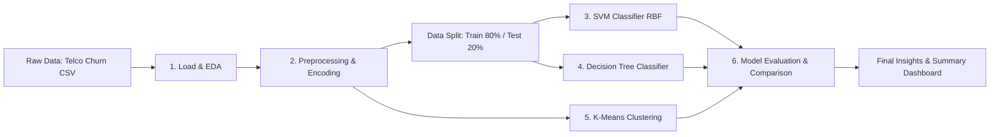

# 📊 Telco Customer Churn Prediction & Customer Segmentation

[](https://www.python.org/)
[](https://scikit-learn.org/)
[](https://pandas.pydata.org/)
[](#)
[](#)

Repositori ini berisi proyek Machine Learning *end-to-end* untuk memprediksi **Customer Churn** (pelanggan yang berhenti berlangganan) dan melakukan **Segmentasi Pelanggan** pada industri telekomunikasi menggunakan dataset **Telco Customer Churn**.

Proyek ini mengimplementasikan metode:
- **Supervised Learning**: **Support Vector Machine (SVM)** dengan RBF Kernel & **Decision Tree** (Gini Impurity).
- **Unsupervised Learning**: **K-Means Clustering** (dengan Elbow Method, Silhouette Analysis, dan visualisasi reduksi dimensi PCA 2D).
- **Evaluasi Komprehensif**: Perbandingan performa model (Accuracy, Precision, Recall, F1-Score, ROC-AUC, Confusion Matrix, Radar Chart).

---

## 📑 Daftar Isi

- [Latar Belakang & Masalah Bisnis](#-latar-belakang--masalah-bisnis)
- [Dataset](#-dataset)
- [Arsitektur & Alur Pipeline](#-arsitektur--alur-pipeline)
- [Hasil Eksperimen & Evaluasi Model](#-hasil-eksperimen--evaluasi-model)
  - [1. Klasifikasi: SVM vs Decision Tree](#1-klasifikasi-svm-vs-decision-tree)
  - [2. Clustering: K-Means Segmentation](#2-clustering-k-means-segmentation)
- [Jawaban Target Analisis & Wawasan Bisnis](#-jawaban-target-analisis--wawasan-bisnis)
- [Galeri Visualisasi](#-galeri-visualisasi)
- [Struktur Direktori](#-struktur-direktori)
- [Panduan Instalasi & Penggunaan](#-panduan-instalasi--penggunaan)
- [Teknologi yang Digunakan](#-teknologi-yang-digunakan)

---

## 🎯 Latar Belakang & Masalah Bisnis

Di industri telekomunikasi, mempertahankan pelanggan lama (*customer retention*) jauh lebih hemat biaya dibandingkan mengakuisisi pelanggan baru (*customer acquisition*). Pelanggan yang berhenti berlangganan (**churn**) menyebabkan penurunan pendapatan secara langsung.

Tujuan utama dari proyek ini adalah:
1. Mengidentifikasi faktor-faktor signifikan yang memicu pelanggan melakukan churn.
2. Membangun model prediktif (SVM dan Decision Tree) untuk mendeteksi pelanggan yang berisiko churn seawal mungkin.
3. Melakukan segmentasi pelanggan (*customer profiling*) berbasis masa berlangganan (*tenure*), metode pembayaran, layanan internet, dan biaya (*charges*) guna merancang strategi retensi yang tepat sasaran.

---

## 📂 Dataset

Dataset yang digunakan adalah **Telco Customer Churn** (`WA_Fn-UseC_-Telco-Customer-Churn.csv`) yang mencakup **7.043 baris** pelanggan dan **21 atribut**:

- **Demografi Pelanggan**: `gender`, `SeniorCitizen`, `Partner`, `Dependents`.
- **Layanan yang Digunakan**: `PhoneService`, `MultipleLines`, `InternetService`, `OnlineSecurity`, `OnlineBackup`, `DeviceProtection`, `TechSupport`, `StreamingTV`, `StreamingMovies`.
- **Informasi Akun & Kontrak**: `tenure` (lama berlangganan dalam bulan), `Contract` (Month-to-month, One year, Two year), `PaperlessBilling`, `PaymentMethod`, `MonthlyCharges`, `TotalCharges`.
- **Target Label**: `Churn` (`Yes` = 1, `No` = 0) dengan rasio ~26.5% Churn dan ~73.5% Tidak Churn (imbalanced class).

---

## ⚙️ Arsitektur & Alur Pipeline

Pipeline proyek dirancang secara modular dan dapat dieksekusi berurutan:



### Rincian Tahapan Preprocessing:
1. **Pembersihan Data**:
   - Menghapus kolom identifier yang tidak informatif (`customerID`).
   - Konversi `TotalCharges` yang bertipe string/spasi kosong menjadi numerik, kemudian mengimputasi nilai kosong dengan **median**.
2. **Encoding Kategorik**:
   - *Binary Mapping & Label Encoding* untuk fitur biner (`gender`, `Partner`, `Dependents`, `PhoneService`, layanan streaming, dll.).
   - *One-Hot Encoding* untuk fitur nominal multi-kategori (`InternetService`, `Contract`, `PaymentMethod`).
3. **Pemisahan Data**:
   - Train-Test Split rasio **80:20** dengan **Stratified Sampling** berdasarkan target `Churn`.
4. **Feature Scaling**:
   - `StandardScaler` untuk normalisasi fitur sebelum masuk ke algoritma berbasis jarak (SVM dan K-Means).

---

## 📈 Hasil Eksperimen & Evaluasi Model

### 1. Klasifikasi: SVM vs Decision Tree

Data uji dievaluasi menggunakan metrik **Accuracy, Precision, Recall, F1-Score, dan ROC-AUC**:

| Model | Accuracy | Precision | Recall | F1-Score | ROC-AUC | Keterangan |
| :--- | :---: | :---: | :---: | :---: | :---: | :--- |
| **Decision Tree (Gini, Depth=5)** | **78.78%** | 59.79% | **61.23%** | **60.50%** | **0.8298** | 🏆 **Model Terbaik** (F1 & Recall unggul) |
| **SVM (RBF Kernel, C=1.0)** | **78.78%** | **62.63%** | 49.73% | 55.44% | 0.7964 | Precision tinggi, namun Recall lebih rendah |

#### Mengapa Decision Tree Dipilih Sebagai Model Utama?
1. **Recall Lebih Tinggi (61.23% vs 49.73%)**: Pada masalah churn, *False Negative* (memprediksi pelanggan tidak churn padahal sebenarnya churn) menimbulkan kerugian besar karena perusahaan kehilangan pelanggan tanpa sempat melakukan intervensi. Decision Tree mampu menangkap lebih banyak pelanggan churn riil.
2. **Keseimbangan F1-Score (60.50% vs 55.44%)**: Memiliki harmonisasi precision dan recall yang lebih solid.
3. **Separasi ROC-AUC Lebih Baik (0.8298 vs 0.7964)**: Memiliki kemampuan diskriminasi probabilitas churn yang lebih superior.
4. **Interpretasi Bisnis Transparan**: Aturan keputusan dapat dipetakan langsung ke pohon keputusan untuk kebutuhan tim operasional/bisnis.

---

### 2. Clustering: K-Means Segmentation

Segmentasi dilakukan menggunakan 5 fitur kunci sesuai perilaku berlangganan:
- `Tenure`, `InternetService`, `PaymentMethod`, `MonthlyCharges`, `TotalCharges`.

#### Evaluasi K-Means:
- **Penentuan K**: Dievaluasi menggunakan **Elbow Method (Inertia)** dan **Silhouette Score** pada rentang $K = [2, 10]$.
- **Skor Klasterisasi ($K = 10$)**:
  - **Silhouette Score**: `0.4142`
  - **Davies-Bouldin Index**: `0.8924` (nilai rendah menunjukkan klaster terpisah dengan baik)
  - **Adjusted Rand Index (ARI)**: `0.0243` (menunjukkan segmentasi menangkap variasi pola baru di luar label churn biner semata)

---

## 💡 Jawaban Target Analisis & Wawasan Bisnis

### 1. Faktor yang Paling Mempengaruhi Customer Churn
Berdasarkan *Feature Importance* (Gini Impurity) dari Decision Tree:
1. **Contract Type (Month-to-Month)**: Pelanggan dengan kontrak bulanan memiliki tingkat churn tertinggi (~42%) dibandingkan kontrak 1 atau 2 tahun (~3-11%).
2. **Tenure (Masa Berlangganan)**: Pelanggan pada kuartal pertama (< 12 bulan) berada pada fase paling rentan churn.
3. **Internet Service (Fiber Optic)**: Churn rate pelanggan Fiber Optic mencapai ~41%, dipicu oleh tingginya biaya bulanan atau ekspektasi kualitas layanan.
4. **Monthly Charges**: Biaya bulanan yang tinggi tanpa diimbangi layanan proteksi mempercepat keputusan churn.
5. **Ketiadaan Layanan Tambahan**: Pelanggan tanpa `TechSupport` atau `OnlineSecurity` jauh lebih rentan meninggalkan layanan.

### 2. Karakteristik Segmen Pelanggan (Hasil K-Means)
- 🔴 **Klaster Berisiko Tinggi (High Churn Risk ~63.4%)**:
  - Karakteristik: Pelanggan baru (*tenure* ~11 bulan), menggunakan *Fiber Optic*, pembayaran *Electronic Check*, biaya bulanan tinggi (~$84.3/bulan).
  - *Rekomendasi Bisnis*: Berikan diskon onboarding, paket bundling perlindungan gratis (TechSupport/Security), dan tawarkan migrasi ke kontrak tahunan dengan potongan tarif.
- 🟢 **Klaster Pelanggan Loyal (Low Churn Risk ~1.1% - 4.1%)**:
  - Karakteristik: Masa langganan panjang (*tenure* > 55 bulan), kontrak 1-2 tahun, pembayaran otomatis (*Credit card / Bank transfer*).
  - *Rekomendasi Bisnis*: Program loyalitas (*reward point*), apresiasi pelanggan setia, dan *cross-selling* layanan streaming premium.

---

## 🖼️ Galeri Visualisasi

Hasil grafik disimpan otomatis di dalam folder [`output_plots/`](output_plots/):

| Kategori | Nama Plot | Deskripsi |
| :--- | :--- | :--- |
| **EDA** | `01_distribusi_churn.png` | Perbandingan rasio target churn (Bar & Pie Chart) |
| **EDA** | `03_heatmap_korelasi.png` | Matriks korelasi antar fitur numerik |
| **EDA** | `04_boxplot_vs_churn.png` | Distribusi tenure, MonthlyCharges, TotalCharges vs Churn |
| **EDA** | `05_kategorik_vs_churn.png` | Persentase churn berdasarkan fitur-fitur kategorikal |
| **SVM** | `06_svm_confusion_matrix.png` | Matriks prediksi benar vs salah model SVM |
| **SVM** | `07_svm_roc_curve.png` | Kurva ROC dan nilai AUC model SVM |
| **Decision Tree** | `08_dt_confusion_matrix.png` | Matriks kebingungan model Decision Tree |
| **Decision Tree** | `09_dt_roc_curve.png` | Kurva ROC dan nilai AUC Decision Tree |
| **Decision Tree** | `10_dt_tree_visualization.png` | Struktur pohon keputusan visual (Max Depth = 5) |
| **Decision Tree** | `11_dt_feature_importance.png` | Peringkat fitur paling berpengaruh terhadap keputusan |
| **K-Means** | `12_kmeans_elbow.png` | Kurva Elbow Method untuk mencari K optimal |
| **K-Means** | `13_kmeans_silhouette.png` | Diagram skor silhouette per nilai K |
| **K-Means** | `14_kmeans_pca_cluster.png` | Pemetaan klaster dalam bidang 2D menggunakan PCA |
| **K-Means** | `15_kmeans_profil_cluster.png` | Perbandingan rata-rata tenure, charges, dan churn rate tiap klaster |
| **K-Means** | `16_kmeans_heatmap_profil.png` | Heatmap normalisasi profil klaster |
| **Evaluasi** | `17_radar_comparison.png` | Radar chart performa SVM vs Decision Tree |
| **Evaluasi** | `18_summary_dashboard.png` | Dashboard ringkasan komprehensif seluruh metrik & hasil |

---

## 📁 Struktur Direktori

```text
telcoMl/
├── WA_Fn-UseC_-Telco-Customer-Churn.csv  # Dataset mentah Telco Churn
├── utils.py                              # Fungsi helper (load data, logging, save plots)
├── load explore .py                      # 1. Exploratory Data Analysis (EDA)
├── preprocessing.py                      # 2. Pembersihan data, encoding, scaling, & splitting
├── svm.py                                # 3. Pemodelan & evaluasi Support Vector Machine
├── decision tree .py                     # 4. Pemodelan & evaluasi Decision Tree Classifier
├── kmeans .py                            # 5. Segmentasi pelanggan dengan K-Means & PCA
├── evaluation compare.py                 # 6. Komparasi performa model & ringkasan analitik
├── runn-all.py                           # Runner script otomatis untuk seluruh pipeline
├── requirements.txt                      # Daftar dependensi library Python
├── .gitignore                            # Konfigurasi file yang diabaikan Git (venv, cache)
├── README.md                             # Dokumentasi proyek
├── output_plots/                         # Direktori penyimpanan seluruh grafik visualisasi (PNG)
│   ├── 01_distribusi_churn.png
│   ├── ...
│   └── 18_summary_dashboard.png
└── results_*.csv                         # Hasil ringkasan metrik (CSV)
    ├── results_svm.csv
    ├── results_dt.csv
    ├── results_kmeans.csv
    └── cluster_profiles.csv
```

---

## 🚀 Panduan Instalasi & Penggunaan

### 1. Clone Repositori
```bash
git clone https://github.com/<username>/telco-customer-churn-ml.git
cd telco-customer-churn-ml
```

### 2. Buat & Aktifkan Virtual Environment
```bash
# Linux / macOS
python3 -m venv venv
source venv/bin/activate

# Windows
python -m venv venv
venv\Scripts\activate
```

### 3. Install Dependensi
```bash
pip install -r requirements.txt
```

### 4. Menjalankan Seluruh Proyek
Anda dapat menjalankan seluruh pipeline sekaligus secara otomatis:
```bash
python runn-all.py
```

Atau menjalankan setiap tahapan satu per satu secara berurutan:
```bash
# 1. Exploratory Data Analysis (EDA)
python "load explore .py"

# 2. Data Preprocessing & Feature Engineering
python preprocessing.py

# 3. Model SVM
python svm.py

# 4. Model Decision Tree
python "decision tree .py"

# 5. K-Means Clustering
python "kmeans .py"

# 6. Komparasi Model & Analisis Akhir
python "evaluation compare.py"
```

Semua visualisasi akan diperbarui dan tersimpan di folder `output_plots/`.

---

## 🛠️ Teknologi yang Digunakan

- **Bahasa Pemrograman**: [Python 3.10+](https://www.python.org/)
- **Data Manipulation & Analysis**: [Pandas](https://pandas.pydata.org/), [NumPy](https://numpy.org/)
- **Machine Learning & Preprocessing**: [Scikit-Learn](https://scikit-learn.org/)
  - `SVC`, `DecisionTreeClassifier`, `KMeans`, `PCA`, `StandardScaler`, `SimpleImputer`
- **Data Visualization**: [Matplotlib](https://matplotlib.org/), [Seaborn](https://seaborn.pydata.org/)

---

## 👨‍💻 Kontributor

- **Indra** - *Machine Learning & Data Analysis*

Jika proyek ini bermanfaat, jangan lupa berikan ⭐ pada repositori ini!
